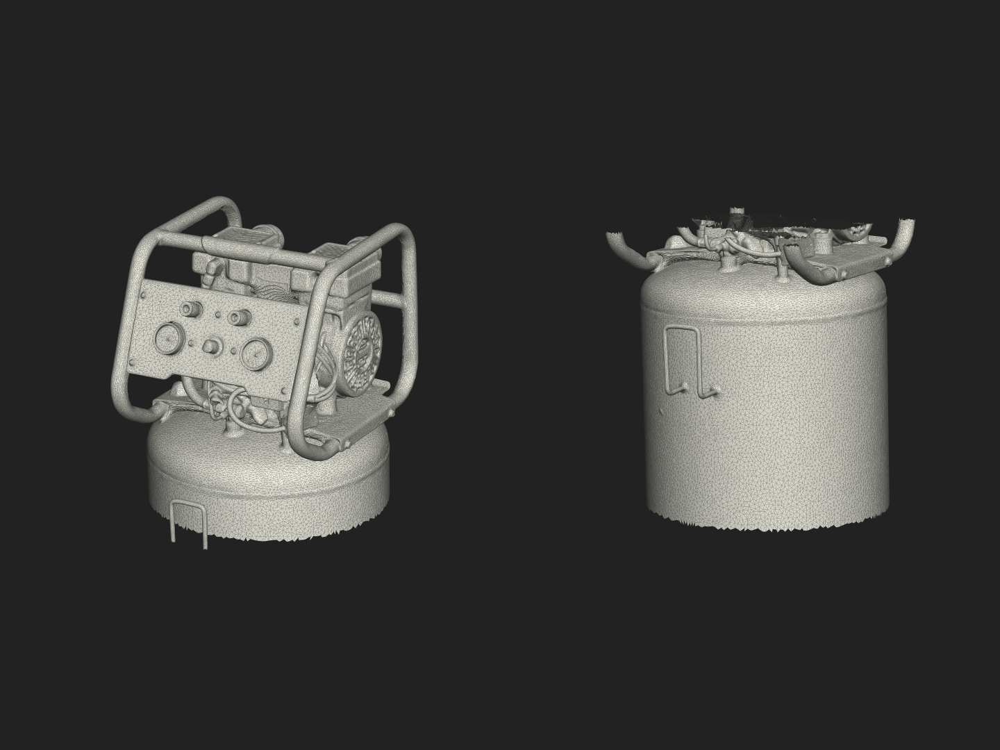
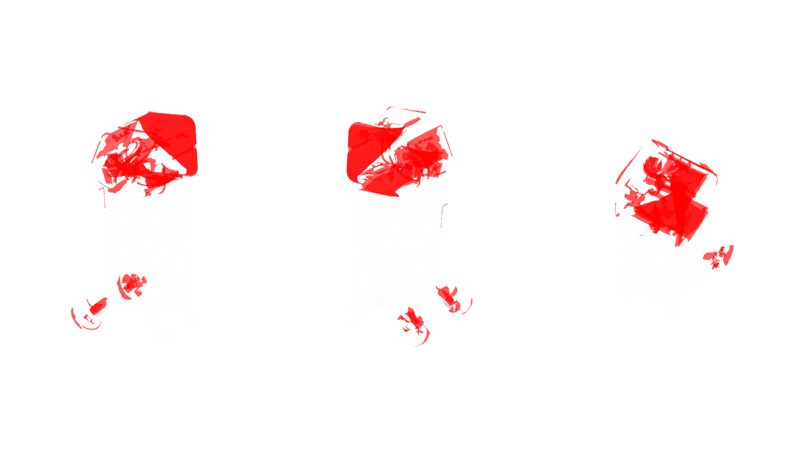
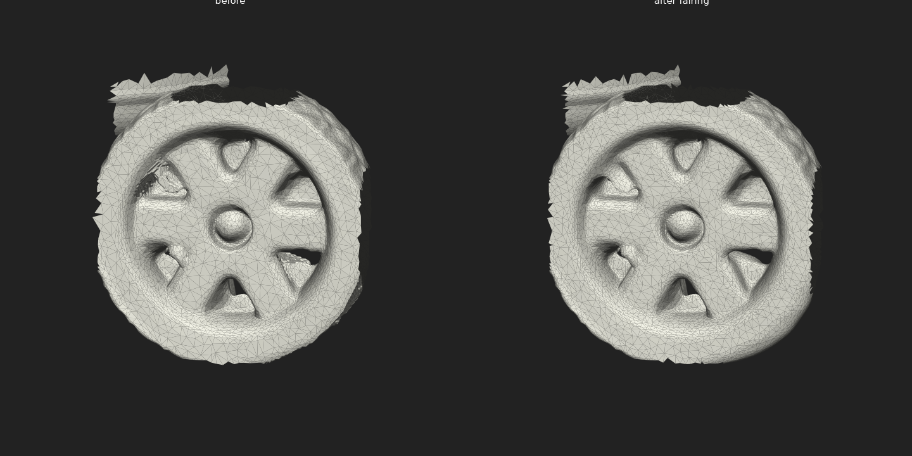

# mesh-solidify

**Turn broken meshes into one watertight, printable solid, with no manual cleanup.**
A [SolidCraft](https://github.com/tangency-labs/solidcraft) plugin and a standalone command line.

Scans, game assets and exported models often have holes, open shells, overlapping parts and
self-intersections. Slicers then report *floating object parts*, *empty layers* or *collapsing
overhangs*, or silently drop half the model. `mesh-solidify` rebuilds the solid from an
inside/outside test, so it doesn't need to understand the holes to close them.



*A 978k-triangle air-compressor scan with 29 holes (the largest has a 1.1 m perimeter) became
one watertight 400k-triangle body in about 35 s on an M-series Mac.*

## SolidCraft plugin

Requires SolidCraft 0.41 or later (plugin capability `commands@0.1`).

1. Download `mesh-solidify-plugin.zip` from the [latest release](https://github.com/JakeMathews/mesh-solidify/releases/latest).
2. In SolidCraft, **Preferences › Plugins › Install plugin…** and pick the zip.
3. Select a mesh body and choose **Plugins › Mesh Solidify › Solidify Mesh…**.

The dialog has every option below, with these defaults: scale **0.1** (10%), which must be a number
greater than 0; detail chosen automatically. The result is added as a new mesh body named
`<body> solid`, and one Undo removes it. **Inspect Mesh…** reports holes, loose parts and size without
changing anything.

> [!WARNING]
> **SolidCraft 0.41.0 limits.** These are the host's limits, not this plugin's, and are expected to
> loosen as SolidCraft's plugin system grows:
>
> - **Input up to 2,730 triangles.** `model.mesh`, the only way a plugin can read a body, sends
>   three vertices per triangle and refuses more than 8,192. For real scans, use the command
>   line below and insert its result with *Insert Mesh*.
> - **Output up to about 30,000 triangles**, since every command a plugin sends is capped at 1 MiB.
> - **About 2 million voxels of work.** The default fuel ceiling (10^11) stops a plugin after
>   roughly 4 s of computation; the default budget of 1.5M voxels uses about 70% of it.
> - **macOS: the signed 0.41.0 build cannot run any plugin.** Its executables lack the JIT
>   entitlement Wasmtime needs, so running a plugin kills the process with *Code Signature
>   Invalid*. This affects every plugin, not just this one. Until SolidCraft fixes it, run plugins
>   from a build without the hardened runtime (for example a source build).

Build the plugin yourself with `scripts/build-plugin.sh` (needs the `wasm32-unknown-unknown` Rust
target and [wasm-tools](https://github.com/bytecodealliance/wasm-tools)).

## Command line

No size limits, all cores, and no Python. Download a binary for your platform from the
[latest release](https://github.com/JakeMathews/mesh-solidify/releases/latest), or build it:

```bash
cargo install --git https://github.com/JakeMathews/mesh-solidify mesh-solidify-cli
```

```bash
mesh-solidify model.stl fixed.3mf --scale 10%
```

```text
mesh-solidify SRC [DST] [options]

  --scale F         uniform scale applied first: 0.1 or 10%             (default 1)
  --voxel F|auto    grid spacing in output mm (detail vs. RAM/time)      (default 0.125)
  --min-feature F   outward offset in output mm to fatten thin parts     (default 0)
  --iso F           winding-number threshold, 0 < iso < 1                (default 0.5)
  --target-faces N  output triangle budget                               (default 400000)
  --fair-tau F      hole-patch distance in voxels; 0 = no fairing        (default 0.5)
  --fair-grow N     extra rings faired around each patch                 (default 2)
  --max-voxels N    refuse larger grids                                  (default 4e8)
  --threads N       worker threads                                       (default all)
  --inspect         report the input's defects only (no DST needed)
  --json            one JSON result object on stdout
  -q, --quiet       no progress output
```

Input: `.stl` (binary or ASCII), `.obj`, `.ply`. Output: `.stl`, `.3mf`, `.obj`, chosen by extension.

### Tuning

| Symptom | Try |
|---|---|
| Thin tubes or rails vanish in the slicer | `--min-feature 0.2` (offsets the whole surface), or a smaller `--voxel` |
| Out of memory, or exit code 4 | the `--voxel` value suggested in the error message, or `--voxel auto` |
| A cavity behind a big opening should be filled | `--iso 0.4` (lower fills more) |
| Fine detail is lost | `--voxel 0.08` (about 2.5× slower) |
| File too big | `--target-faces 200000` |

Rough cost on an M-series Mac: 130M voxels take about 35 s and 3 GB of RAM; 400M voxels about
35 s and 2 GB (the grid costs 1 byte per voxel; work grows with the surface, not the volume).

## Why not just "close holes"?

Hole-filling tools triangulate each boundary loop. That works for small flat holes. On large 3D
holes the patches cut straight through the model: the result is technically watertight but wrong.



*MeshLab's close-holes on the same model: "watertight", with flat sheets (red) cutting through
the motor and frame. Self-intersections went from 649 to 5,456.*

## How it works

1. **Scale to print size first**, so every tolerance is in real print millimetres.
2. **Generalized winding number** ([Jacobson et al. 2013](https://igl.ethz.ch/projects/winding-number/)),
   computed fast with a BVH and dipole far field ([Barill et al. 2018](https://www.dgp.toronto.edu/projects/fast-winding-numbers/)).
   It gives a robust inside/outside answer even with holes and overlapping shells. The field is
   smooth away from the surface, so it is sampled on an octree: only a thin shell around the
   surface is evaluated at full resolution (8–25% of the grid).
3. **Keep the largest connected solid**, drop floating specks, fill enclosed voids.
4. **Narrow-band signed distance**: the sign comes from the winding number and the magnitude is
   the exact distance to the input triangles. Real surfaces come out smooth, with no voxel steps.
5. **Marching tetrahedra**, which can't crack or produce non-manifold edges.
6. **Hole-patch fairing**: vertices far from every input triangle were invented to close a hole.
   They are solved as a biharmonic surface with the real geometry held fixed, so patches continue
   the curvature around them instead of terracing.
7. **Quadric decimation** to the triangle budget, with link-condition, fold-over and shape-quality
   checks so the mesh stays closed and manifold, then verification (watertight, oriented, one body,
   positive volume).



## For agents and scripts

- **`--json`**: progress goes to stderr; stdout gets exactly one JSON object with `ok`,
  `watertight`, `bodies`, `size_mm`, `triangles`, `faired_vertices`, `grid`, `voxel_mm` and the
  parameters used.
- **`--inspect --json`**: a cheap check before committing to a full run (holes, hole perimeters,
  components, size at the given scale).
- **Exit codes**: `0` ok, `1` error, `2` bad arguments, `3` output failed verification, `4` grid
  too large (the message includes a `--voxel` that fits).
- **Validated arguments**: non-numeric, zero, negative, NaN and out-of-range values are refused
  with a readable message before any work starts. Counts accept `4e8` and `400_000_000`.
- **Agent skill**: [`skills/mesh-solidify/SKILL.md`](skills/mesh-solidify/SKILL.md) is a
  ready-made Claude Code skill. Drop the folder into `.claude/skills/`.
- **Library**: the `mesh-solidify` crate (`crates/core`) has no I/O or platform dependencies and
  builds for WebAssembly: `mesh_solidify::solidify(&mesh, &Params { scale: 0.1, ..Default::default() }, &NoMonitor)`.

```console
$ mesh-solidify broken.stl --inspect --scale 10% --json -q
{ "ok": true, "watertight": false, "components": 3, "holes": 29,
  "largest_hole_perimeters_mm": [1105.0, 150.39, ...], "size_mm": [45.16, 50.62, 104.14], ... }
```

## Limitations

- **The output is solid.** Enclosed hollow interiors come out filled.
- **Only the largest connected solid is kept.** Loose separate parts are dropped; the JSON reports
  how many voxels were dropped. At coarse detail (the plugin's automatic voxel size on large
  models) a thin connection can break and a part can be dropped; use a finer `voxel`.
- **Features thinner than about one voxel can disappear.** Lower `--voxel` or use `--min-feature`.
- **Sharp edges are slightly rounded** at the voxel scale.

## Repository

| Path | What |
|---|---|
| `crates/core` | The algorithm, as a dependency-free Rust library |
| `crates/cli` | The `mesh-solidify` command line |
| `crates/plugin` | The SolidCraft plugin (WebAssembly component) and its `plugin.json` |
| `python/` | The original Python implementation (0.1.x), kept for reference |
| `skills/` | Claude Code skill |

## License

[MIT](LICENSE). The SolidCraft plugin interface (`crates/plugin/wit/plugin.wit`) comes from
SolidCraft, which is MIT/Apache-2.0 licensed.
